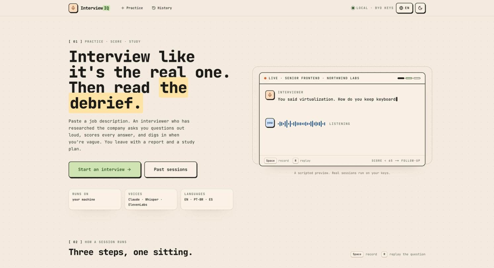
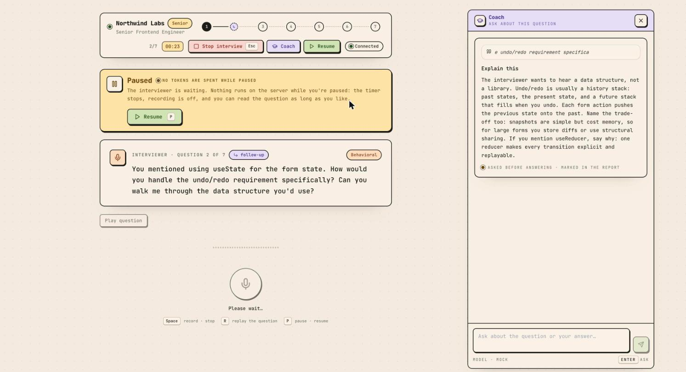
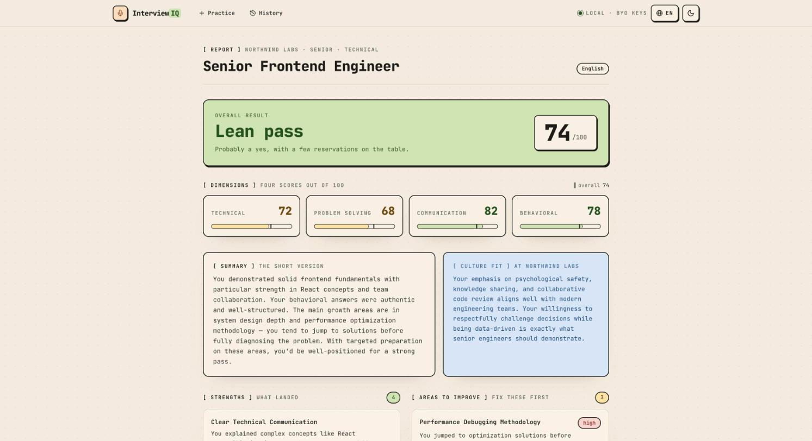

# InterviewIQ

AI mock interviews you run on your own machine.

[](https://github.com/lourencopassos/interviewiq/actions/workflows/ci.yml)
[](LICENSE)



<table>
  <tr>
    <td width="50%"></td>
    <td width="50%"></td>
  </tr>
  <tr>
    <td><sub>Pause any time and ask the coach about the question or your answer.</sub></td>
    <td><sub>A coaching report with a verdict, four scores and a study plan.</sub></td>
  </tr>
</table>

**Who this is for:** job seekers practising tech interviews in English, Portuguese or Spanish. It is a practice tool, not an assessment: scores are an AI's opinion meant to point you at what to study.

Paste a job description. InterviewIQ parses it, researches the company, and runs an adaptive **voice interview**: an AI interviewer asks questions out loud, you answer with your microphone, each answer is scored in real time, and weak answers get follow-ups. At the end you get a coaching report with dimension scores, strengths, gaps, a prioritized study plan, and tips for the real thing.

It is **self-hosted, single-user and bring-your-own-keys**. It runs as one Node process on `127.0.0.1` next to a local Postgres, and talks only to the AI providers you configure. There is **no login**: read [Security and privacy](#security-and-privacy) before exposing it beyond your own machine.

- **Interviewer:** Anthropic Claude (configurable model, default `claude-sonnet-5`)
- **Speech to text:** OpenAI Whisper
- **Text to speech:** ElevenLabs
- **Optional video interviewer:** D-ID real-time avatar over WebRTC

See [ARCHITECTURE.md](ARCHITECTURE.md) for how the real-time pipeline works and [docs/design-system.md](docs/design-system.md) for the UI language.

## Features

- Job description parsing into skills, seniority, domain and interview focus
- Company research with web search, cached for a week per company
- Adaptive question flow: follow-ups when an answer scores under 65, skips of easy questions after a very strong answer
- Interview types: phone screen, technical, behavioral, system design, and **Full Loop** (all four stages in one session with spoken transitions)
- Difficulty levels junior to staff; interviews in English, Brazilian Portuguese or Spanish
- Interface in English, Português or Español, switchable from the nav
- **Pause and ask the coach** (`P`): nothing runs and nothing is billed while paused. Highlight part of the question or your transcript and get it explained by a small, cheap model. Asking before you answer is marked in the report; the study plan uses what you asked.
- **Stop the interview** any time (`Esc`)
- **Saved postings and CV**: keep job descriptions and your CV text in the browser and reuse them; the CV makes questions reference your background
- Optional video interviewer (D-ID avatar) with your webcam as a self-view
- Coaching report with verdict, four dimension scores, study plan with resources, per-question review, and PDF export via print
- Session history, resume of interrupted interviews, and refresh-safe state (everything authoritative lives in Postgres)
- **Mock mode** for development: the whole flow, including job parsing and company research, runs on canned fixtures with no API keys and no spend

## Before you start

- **Node.js 20.19 or newer.** The repo has an `.nvmrc`, so `nvm use` picks the right version.
- **pnpm via corepack:** run `corepack enable` once; it picks up the pinned pnpm version.
- **Docker** installed and running, for the local Postgres container.
- **A Chromium browser** (Chrome or Edge) is what it is tested on. Firefox and Safari should work through the recorder's audio-format fallback; please [report issues](https://github.com/lourencopassos/interviewiq/issues).
- **Microphone access needs a secure context:** open the app at `http://localhost:3000` (or over HTTPS). A LAN IP over plain HTTP will not get the microphone.
- **API keys** (not needed for mock mode):

| Provider | Needed for | |
|---|---|---|
| Anthropic | Every prompt, plus company research | **Required.** Web search must be enabled for your Anthropic organization by an admin in the Anthropic Console; it is billed per search. |
| OpenAI | Whisper transcription of your answers | **Required** |
| ElevenLabs | The interviewer's voice | **Required** |
| D-ID | Video interviewer | Optional. Needs D-ID credits, and your plan caps concurrent streams. A stream from a closed tab lingers until D-ID's idle timeout, so reopening quickly can hit the cap. |

## Quick start

```bash
git clone https://github.com/lourencopassos/interviewiq.git
cd interviewiq
nvm use                 # optional, reads .nvmrc
corepack enable
pnpm install

cp .env.example apps/web/.env.local            # app config: add your API keys here
cp packages/db/.env.example packages/db/.env   # Prisma CLI: only DATABASE_URL

pnpm db:setup           # starts Postgres and waits until it is healthy, then pushes the schema
pnpm dev                # http://localhost:3000
```

Open `http://localhost:3000/new`, paste a job description, pick the interview type, and start. Your browser will ask for microphone access.

Postgres listens on host port **5436** (not the usual 5432) so it does not clash with a Postgres you may already run, and only on `127.0.0.1`, so nobody else on your network can reach it.

**Sample report (optional):** `pnpm db:seed` inserts one completed interview for a fictional company and prints its report URL. History is per browser, so the sample is not listed there by default. To attach it to your browser, run `pnpm db:seed <your-client-id>`; your id is in DevTools → Application → Local Storage → `interviewiq-client-id`. History then shows the sample.

**Port and host:** `PORT=3100 pnpm dev` changes the port. The app binds to `127.0.0.1` on purpose; see [Security and privacy](#security-and-privacy) before changing that.

### Environment variables

All of these go in `apps/web/.env.local`. `packages/db/.env` only needs `DATABASE_URL` for the Prisma CLI.

| Variable | Required | Purpose |
|---|---|---|
| `ANTHROPIC_API_KEY` | yes | All prompts and company web search |
| `OPENAI_API_KEY` | yes | Whisper transcription of your answers |
| `ELEVENLABS_API_KEY` | yes | Interviewer voice |
| `DATABASE_URL` | yes | Postgres connection string. The default matches `docker-compose.yml`. |
| `CLAUDE_MODEL` | no | Model for every prompt except the coach. Default `claude-sonnet-5`. |
| `COACH_MODEL` | no | Model for the mid-interview coach. Default `claude-haiku-4-5`. |
| `ELEVENLABS_VOICE_EN` / `_PT_BR` / `_ES` | no | ElevenLabs voice id per interview language |
| `DID_API_KEY` | no | Enables the video interviewer |
| `DID_PRESENTER_URL` | no | Portrait image for the avatar. Defaults to a public D-ID sample. |
| `POSTGRES_PASSWORD` | no | Password for the Docker Postgres (default `interviewiq`). `docker compose` reads it from your shell or a root `.env`; update both `DATABASE_URL`s to match. |

If a required key is missing, the first call that needs it fails with a clear message such as "ANTHROPIC_API_KEY is not set".

### Mock mode (no keys, no spend)

In development (`pnpm dev`) a small toggle appears in the bottom-left corner of every page. Turn it on and everything runs on fixtures: job parsing, company research (a fictional "Northwind Labs"), questions, evaluations, transcripts, and a silent audio placeholder, with the browser's own speech synthesis reading questions aloud. No API keys are needed and nothing is billed.

Mock mode is a cookie scoped to your browser and is ignored in production builds.

## Run with Docker

To run the production build in a container instead of `pnpm dev`:

```bash
cp .env.example apps/web/.env.local                # if you have not already; add your API keys
docker compose --env-file apps/web/.env.local --profile app up -d --build   # http://localhost:3000
```

- **Env:** `--env-file apps/web/.env.local` passes your keys to the `app` container at runtime; they are never copied into the image. `DATABASE_URL` is overridden to point at the `db` service, so the container uses the same Postgres (and data) as `pnpm dev`.
- **Schema:** a one-shot `migrate` service runs `prisma db push` before the app starts.
- **Port and host:** published on `127.0.0.1` only. `APP_PORT=3300 docker compose --env-file apps/web/.env.local --profile app up -d` changes the host port. It is still a single-user app with no login, so the same rules as [Security and privacy](#security-and-privacy) apply.
- **Stop:** `docker compose --profile app down` (add `-v` only if you also want to delete the database volume). Plain `docker compose up` / `pnpm db:up` still start only Postgres.
- Mock mode is disabled in production builds, so the container needs real API keys.

## Costs

Every real interview calls paid APIs on your accounts. These are **rough estimates**; actual cost depends on the provider prices at the time, your plans, the model you pick and how long you talk.

- **Single-stage interview** (5 to 8 questions, by difficulty): mostly Claude (parse, a few web searches, one question set, one evaluation per answer, one report), plus Whisper minutes for your answers and ElevenLabs characters for every spoken line. Expect somewhere around **US$0.50 to $2**.
- **Full Loop:** four question sets and 15 to 20 answers, roughly **3 to 4 times** a single stage.
- **Video mode:** D-ID bills per streamed minute on top of the above.
- **Coach questions** run on the cheaper `COACH_MODEL` and are small; pausing costs nothing.

Use mock mode while developing.

## Security and privacy

- **No authentication.** InterviewIQ is a single-user app. Sessions belong to an anonymous id stored in your browser (and mirrored to a cookie); session routes check that id, and cross-site requests to the API are rejected. That protects you from other web pages, not from other people who can reach the server.
- **Local by default.** `pnpm dev` and `pnpm start` bind to `127.0.0.1`, and Postgres binds to `127.0.0.1:5436`.
- **Exposing it is a deliberate choice.** To reach it from another device, run it with `-H 0.0.0.0` (for example `pnpm --filter web exec next start -H 0.0.0.0`) **only behind a reverse proxy that does authentication**. Anyone who can reach an exposed instance can spend your API keys.
- **What leaves your machine:** the job description, company name, your CV text, question text and transcripts go to **Anthropic** (prompts and web search). Your recorded answers go to **OpenAI** (Whisper). Every spoken line goes to **ElevenLabs**. In video mode, spoken lines also go to **D-ID**. Each provider's own data policy applies.
- **What stays on your machine:** sessions, CVs, transcripts, scores, coach notes and reports are stored **in plaintext** in your local Postgres. Saved postings and the CV are also kept in your browser's localStorage.
- **No automatic purge.** Data stays until you delete it. Use **Delete all my data** on the History page to delete every session for your browser and clear the saved CV and postings from localStorage, or delete sessions one by one. `pnpm db:down` stops the database; `docker compose down -v` also deletes its volume.
- **Company research cache** is keyed by company name and shared by everyone using the same deployment.

See [SECURITY.md](SECURITY.md) for the threat model and how to report a vulnerability.

## Scripts

| Command | What it does |
|---|---|
| `pnpm dev` | Start the web app in dev mode on `127.0.0.1:3000` |
| `pnpm build` | Production build (only the web app emits output) |
| `pnpm start` | Serve the production build on `127.0.0.1:3000` |
| `pnpm lint` | ESLint over the web app |
| `pnpm typecheck` | TypeScript check in every workspace |
| `pnpm test` | Unit tests (`node:test`) |
| `pnpm format` / `pnpm format:check` | Prettier write / check |
| `pnpm db:up` / `pnpm db:down` | Start (and wait for) or stop the Postgres container |
| `pnpm db:setup` | Start Postgres and push the schema (first run) |
| `pnpm db:push` | Push schema changes after editing `schema.prisma` |
| `pnpm db:seed` | Insert the sample interview (`pnpm db:seed <client-id>` to attach it to your browser) |
| `pnpm db:studio` | Open Prisma Studio |

## Project layout

```
apps/web          Next.js 15 app: pages, components, hooks, thin API routes
packages/ai       Prompts, interview orchestrator, audio/avatar pipelines, caches, SSE, mock mode
packages/types    Shared Zod schemas, enums and the SSE event protocol
packages/db       Prisma schema, client singleton, seed
docs/             Design system, feature backlog, and docs/history (planning-era documents)
```

## Running it somewhere other than your laptop

The only supported shape is **one long-lived Node process** (`pnpm build && pnpm start`, or the Docker image from [Run with Docker](#run-with-docker), which serves Next's standalone output) next to Postgres, on localhost or behind your own authenticating reverse proxy. Live SSE connections, generated audio clips, rate-limit counters and interview locks live in process memory. Interview state itself is always in Postgres, so a restart is safe: the browser reconnects and the current question is replayed.

That design does **not** fit multi-instance or serverless hosting (for example Vercel functions), where the SSE stream, the answer upload and the audio fetch can land on different instances.

## Contributing

Issues and pull requests are welcome. See [CONTRIBUTING.md](CONTRIBUTING.md) for setup, checks and conventions, and [CODE_OF_CONDUCT.md](CODE_OF_CONDUCT.md).

## Third-party assets

- The default video presenter image is a public D-ID sample (`DID_PRESENTER_URL` to use your own).
- Default voices are ElevenLabs premade voices.
- The UI font is JetBrains Mono, under the SIL Open Font License 1.1.

## License

[MIT](LICENSE)
